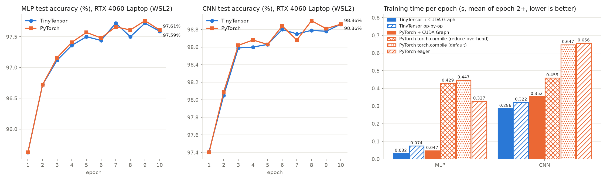
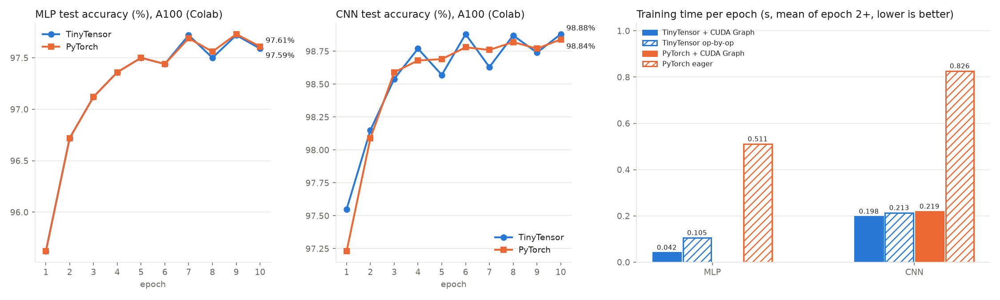
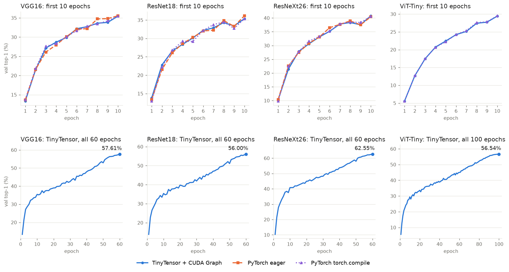
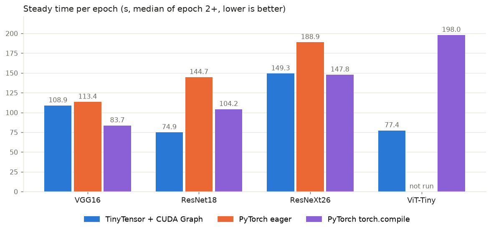

[English](README.md) | **简体中文**

# pku-aiprogramming

北京大学 2023 年《人工智能中的编程》课程作业，以及在它基础上继续做下去的内容。

课程作业一步步搭出一个小型深度学习框架 **TinyTensor**：CUDA 张量类、各种层、Python 绑定、自动微分、优化器，最后在
MNIST 上训练。这是**第一部分（基础）**。**第二部分（拓展）**把同一个框架推得更远：tensor core 卷积、BatchNorm、
注意力、bf16 混合精度、CUDA Graph 和手写融合 kernel，足以在一张 A100 上训练 64x64 的 ImageNet-1k（VGG16、ResNet18、
ResNeXt26、ViT-Tiny），并逐步与 PyTorch 对比速度和准确率。

## 请不要直接抄袭本仓库用于你的课程作业！

## 目录结构

```
tinytensor/              框架本身：一个 Python 包，组织方式与 PyTorch 一致
  tensor.py              Tensor（计算图的节点）和基本算子
  autograd/              反向模式自动微分
  nn/                    Module、Parameter 和各种层
    functional.py        无状态的算子（F.conv2d、F.linear、F.batch_norm 等）
    intrinsic.py         融合层（LinearReLU、ConvReLUMaxPool2d、ConvBNAct2d 等）
    init.py              参数初始化
  optim/                 SGD、Adam、AdamW、学习率调度
  utils/data.py          把数据集放在 GPU 上的数据加载器
  cuda.py                同步、显存信息、CUDA Graph 的录制与回放
  models/                MLP / CNN（MNIST），VGG16 / ResNet18 / ResNeXt26 / ViT-Tiny
  csrc/                  C++/CUDA 源码：张量、层，以及 csrc/nn（tensor core 卷积、BN、LN、注意力、bf16）
  _C/                    编译出的三个扩展模块（由 build_linux.sh 写入）
build_linux.sh           用 nvcc 把 tinytensor/csrc 编译到 tinytensor/_C
tests/                   算子测试、与 PyTorch 的对照、端到端的逐步对齐
experiments/
  mnist/                 Task 3：MNIST 上的 MLP / CNN、PyTorch 基线、profiler、bench.sh
  imagenet/              第二部分：ImageNet64 / Tiny ImageNet 训练、PyTorch 基线、profiler、卷积微基准
basics/                  第一部分：课程作业 HW1-HW5 和大作业 Task 1-2（见 basics/README.zh-CN.md）
results/                 本文所有数字的原始 json，以及画图脚本
```

## 这个包

TinyTensor 的用法与 PyTorch 相同：

```python
import tinytensor as tt
from tinytensor import nn, optim
import tinytensor.nn.functional as F


class Net(nn.Module):
    def __init__(self):
        super().__init__()
        self.conv1 = nn.Conv2d(1, 16, 3, padding=1)
        self.conv2 = nn.Conv2d(16, 32, 3, padding=1)
        self.fc1 = nn.Linear(32 * 7 * 7, 128)
        self.fc2 = nn.Linear(128, 10)

    def forward(self, x):
        x = F.max_pool2d(F.relu(self.conv1(x)), 2)
        x = F.max_pool2d(F.relu(self.conv2(x)), 2)
        x = F.relu(self.fc1(x.flatten(1)))
        return self.fc2(x)


model = Net()
criterion = nn.CrossEntropyLoss()
optimizer = optim.SGD(model.parameters(), lr=0.1)

x, y = tt.tensor(images), tt.tensor(labels)     # numpy -> GPU
optimizer.zero_grad()
loss = criterion(model(x), y)
loss.backward()
optimizer.step()
print(loss.numpy())                             # 只有这里会同步 GPU
```

各部分的分工：

- **`nn.functional`（`F`）放算子。** 每个函数是计算图上的一个节点，前向和反向各调用一到两个 CUDA kernel。它没有
  状态，权重由调用方传入。
- **`nn` 放层。** 层是一个 `Module`，持有自己的 `Parameter` 和 buffer（例如 BatchNorm 的滑动统计量），在 `forward`
  里调用 `F`。两者都需要，理由和 PyTorch 一样：`F.relu`、`F.max_pool2d` 没有东西可持有，而 `nn.Conv2d` 必须持有
  一份优化器能找到的权重。
- **`nn.intrinsic` 放融合层**，与 `torch.nn.intrinsic` 相同。`nni.LinearReLU` 是 `nn.Linear` 接 `F.relu`，由一个
  kernel 算完；`nni.ConvReLUMaxPool2d` 是卷积 + ReLU + 2x2 最大池化合成一个 kernel；`nni.ConvBNAct2d` 是卷积，然后
  BatchNorm + 残差相加 + ReLU 合成一个 kernel。每个融合层的参数和结果都与未融合的写法一致，所以融合只是选哪个层
  类，而不是另一套算子。模型有 `fused` / `fuse` 开关，在两种写法之间切换。
- **算子只有一套，背后有两族 kernel，按内存格式选择**，思路与 PyTorch 的 `memory_format` 相同：

  | | `tt.contiguous_format`（默认） | `tt.channels_last` |
  |---|---|---|
  | 布局 | NCHW | NHWC |
  | kernel | 课程作业的 kernel（`myLayer`）：直接卷积和 im2col 卷积，fp32 | `myNN`：tensor core 卷积、分组卷积、BatchNorm、LayerNorm、注意力；fp32 或 bf16 |
  | 使用者 | MNIST MLP / CNN | VGG16、ResNet18、ResNeXt26、ViT-Tiny |

  `model.to(memory_format=tt.channels_last)` 选择 kernel 族和权重的物理布局；`model.to(tt.bfloat16)` 打开混合精度。
  `F.conv2d`、`F.linear`、`F.relu`、`F.max_pool2d`、`F.cross_entropy` 两种格式都支持；BatchNorm、LayerNorm、注意力、
  GELU 和分组卷积只在 `channels_last` 下有，`F.conv_relu_max_pool2d` 只在 `contiguous_format` 下有。某个格式下没有
  对应 kernel 时，算子抛出 `NotImplementedError`。

TinyTensor 有意与 PyTorch 不同的地方：

- **参数延迟创建。** 层只声明形状和初始化方式，数值在模型第一次使用时才在 GPU 上生成，所以可以先调用
  `model.to(memory_format=...)` 和 `model.manual_seed(seed)`。
- **`model.flatten_parameters()`** 把所有参数放进一块连续的缓冲区。之后 `fused=True` 的优化器用一个 kernel 更新全部
  参数（这个 kernel 同时根据 GPU 上的步数计数器算学习率，并写出权重的 bf16 副本），`optimizer.zero_grad()` 就是一次
  memset。
- **数据加载器在 GPU 上。** `utils.data.TensorLoader` 和 `ImageLoader` 只上传一次数据集；`next()` 是一个 kernel，
  取出这个 batch（对图像还做裁剪、翻转和归一化）。
- **`tt.cuda.GraphRunner`** 把连续若干个训练步录成一个 CUDA Graph 再回放。能这样做，是因为一整步（取 batch、前向、
  反向、更新、学习率）都不需要 CPU 读回任何东西。
- **`channels_last` 下 `nn.CrossEntropyLoss` 在 GPU 上累加** loss 之和与预测正确的个数；`criterion.statistics()` 读出
  并清零，通常每个 epoch 读一次。
- **不支持：** 权重共享（一个参数在一次前向里只能被一个算子使用）、卷积偏置、层算子在 CPU 上执行。

## 环境与构建

本地的一切都在 RTX 4060 Laptop 的 WSL2 里运行。A100 的实验用 Colab。

| 项目 | 本地（WSL2） | A100（Colab） |
|---|---|---|
| GPU | RTX 4060 Laptop，8 GB | A100-SXM4-80GB |
| 系统 | WSL2 里的 Ubuntu 20.04.6，宿主 Windows 11 | Colab 运行时 |
| 编译器 | gcc 11.5，CUDA toolkit 12.8 | CUDA 13 |
| Python | 3.12，numpy、pybind11、pytest、matplotlib | 相同 |
| PyTorch | 2.14.1+cu126，torchvision 0.29.1 | 2.11.0+cu130 |

在 WSL 里从零搭环境（NVIDIA 驱动来自 Windows，只需安装 `cuda-toolkit-12-8` 这个包）：

```bash
python3.12 -m venv ~/tt-venv
~/tt-venv/bin/pip install numpy pybind11 pytest matplotlib torch torchvision --index-url https://download.pytorch.org/whl/cu126
```

在仓库根目录构建 TinyTensor。脚本只需要 nvcc、numpy 和 pybind11 头文件。它编译 `tinytensor/csrc`，把扩展模块
`myTensor`、`myLayer`、`myNN` 写到 `tinytensor/_C/`：

```bash
PYTHON=~/tt-venv/bin/python NVCC=/usr/local/cuda-12.8/bin/nvcc ./build_linux.sh
```

之后在仓库根目录（或把根目录加进 `PYTHONPATH`）就能 `import tinytensor`；`experiments/` 和 `tests/` 里的脚本会自己
加上这个路径。

从 Windows 调用 WSL 请用 PowerShell：`wsl -d Ubuntu-20.04 -- bash script.sh`。Git-Bash 会在传给 WSL 之前改写 `$var`
和 `/mnt/...` 路径，所以多行命令请写进脚本文件。

# 第一部分：基础

五次作业和一个包含三个任务的大作业。[`basics/README.zh-CN.md`](basics/README.zh-CN.md) 说明了每个作业的内容和运行
方法。每一项都能在本地运行（RTX 4060 Laptop，WSL2，上面的环境）：

| 项目 | 内容 | 结果 |
|---|---|---|
| HW1 | 用 PyTorch 在 CIFAR-10 上训练 LeNet，SGD 动量 0 / 0.7 / 0.8 / 0.9 | 10 个 epoch，测试准确率 45.99% / 61.66% / 64.57% / 65.06% |
| HW2 | CUDA 张量类和层（全连接、卷积、最大池化、softmax、交叉熵）的前向与反向 | 10 个 C++ 自测运行，与 PyTorch 的 4 / 4 项对照通过 |
| HW3 | 用 pybind11 把同样的张量和层暴露给 Python | 4 / 4 项层测试通过；MNIST 能读入 GPU 张量 |
| HW4 | 用 Python 实现算子、拓扑排序和反向模式自动微分 | 22 / 22 项测试通过 |
| HW5 | 在 MNIST 上用 SGD 和 Adam 训练两层网络 | 20 个 epoch，测试错误率 2.77%（SGD）和 2.94%（Adam） |
| Task 1 | 用 PyTorch 在 MNIST 上训练 CNN | 10 个 epoch，测试准确率 98.61%，104.9 s |
| Task 2 | 同一个 CNN 加上 `nn.DataParallel`（只有一张 GPU，所以测到的是开销） | 普通 98.64%，104.7 s；`nn.DataParallel` 98.66%，105.2 s |
| Task 3 | 用自己写的框架在 MNIST 上训练 | 见下一节 |

## Task 3：TinyTensor 在 MNIST 上

训练一个 MLP（784-100-10）和一个 CNN（两段 3x3 卷积 + ReLU + 2x2 最大池化，通道数 16 和 32，然后是 128 个单元的
隐藏层），10 个 epoch，SGD，学习率 0.1，batch 100，种子 0。PyTorch 从相同的初始权重、按相同的数据顺序训练同一个
网络。

在 `experiments/mnist` 里运行：

```bash
python ../../tests/test_ops.py          # 算子检查、CNN 有限差分、融合 == 未融合、CUDA Graph == 逐算子
python mnist_mlp.py --epochs 10         # TinyTensor MLP（默认用 CUDA Graph，--no-graph 为逐算子）
python mnist_cnn.py --epochs 10         # TinyTensor CNN
python torch_baseline.py --arch cnn     # PyTorch 里相同的模型 / 初始化 / 数据顺序（eager）
python torch_baseline.py --arch cnn --graph                     # PyTorch + 手动 CUDA Graph
python torch_baseline.py --arch cnn --compile reduce-overhead   # PyTorch + torch.compile（也可用 default）
python profile_step.py --framework tiny --arch cnn --graph      # 用 torch.profiler (CUPTI) 看每个 kernel 的 GPU 时间和时间线
```

通用选项：`--optimizer sgd|adam --lr --batch --seed --chunk --data <MNIST raw 目录> --save <json>`。`bench.sh` 在同一个
环境里把十二种配置连续跑完，`results/mnist/plot_results.py` 根据保存的 json 画图：

```bash
PYTHON=~/tt-venv/bin/python DATA=<MNIST raw 目录> EPOCHS=10 SAVE=<repo>/results/mnist/rtx4060 ./bench.sh
python ../../results/mnist/plot_results.py rtx4060
```

模型是 `tinytensor.models.MLP` 和 `tinytensor.models.CNN`，`experiments/mnist/tiny_trainer.py` 是围绕它们的训练循环。
TinyTensor 自己初始化权重：用 CUDA 的 `random` kernel 做 Kaiming 均匀初始化（`nn.init.kaiming_uniform_`）。TinyTensor
的脚本把初始权重导出到 `results/mnist/init/<arch>_seed<seed>.npz`，`torch_baseline.py` 读取同一个文件，所以要先运行
TinyTensor 的脚本。

### 结果

s/epoch 是第 2-10 个 epoch 的平均值，因为第 1 个 epoch 包含 CUDA Graph 录制或 torch.compile 的编译时间。

**框架之间的对比请以 A100 的表为准。** 笔记本的 GPU 功率状态取决于 Windows 的电源模式，它的计时只能在同一次连续
运行内相互比较。笔记本的表是在电源模式设为"性能"时测的。

**RTX 4060 Laptop，WSL2**（`results/mnist/rtx4060/`）：

| 模型 | 模式 | s/epoch | 测试准确率 |
|---|---|---|---|
| MLP | **TinyTensor + CUDA Graph** | **0.032** | 97.59% |
| MLP | TinyTensor 逐算子 | 0.074 | 97.59% |
| MLP | PyTorch + CUDA Graph | 0.047 | 97.61% |
| MLP | PyTorch eager | 0.327 | 97.61% |
| MLP | PyTorch torch.compile（default） | 0.447 | 97.61% |
| MLP | PyTorch torch.compile（reduce-overhead） | 0.429 | 97.61% |
| CNN | **TinyTensor + CUDA Graph** | **0.286** | 98.86% |
| CNN | TinyTensor 逐算子 | 0.322 | 98.91% |
| CNN | PyTorch + CUDA Graph | 0.353 | 98.86% |
| CNN | PyTorch eager | 0.656 | 98.74% |
| CNN | PyTorch torch.compile（default） | 0.647 | 98.78% |
| CNN | PyTorch torch.compile（reduce-overhead） | 0.459 | 98.83% |

两个模型上最快的配置都是 TinyTensor + CUDA Graph：MLP 上比 PyTorch 加手动 CUDA Graph 快 1.5 倍，CNN 上快 1.2 倍。
排名与 A100 上一致。



**A100**（`results/mnist/a100/`）：

| 模型 | 模式 | s/epoch | 测试准确率 |
|---|---|---|---|
| MLP | **TinyTensor + CUDA Graph** | **0.040** | 97.59% |
| MLP | TinyTensor 逐算子 | 0.109 | 97.59% |
| MLP | PyTorch + CUDA Graph | 0.060 | 97.61% |
| MLP | PyTorch eager | 0.537 | 97.61% |
| MLP | PyTorch torch.compile（default） | 0.795 | 97.60% |
| MLP | PyTorch torch.compile（reduce-overhead） | 0.693 | 97.60% |
| CNN | **TinyTensor + CUDA Graph** | **0.197** | 98.88% |
| CNN | TinyTensor 逐算子 | 0.212 | 98.87% |
| CNN | PyTorch + CUDA Graph | 0.219 | 98.74% |
| CNN | PyTorch eager | 0.901 | 98.80% |
| CNN | PyTorch torch.compile（default） | 1.079 | 98.79% |
| CNN | PyTorch torch.compile（reduce-overhead） | 0.745 | 98.77% |

这张表用本仓库现在的包测得（commit `08e4993`，PyTorch 2.11，CUDA 13），测之前 `tests/test_ops.py` 和
`tests/test_nn_ops.py` 在同一台机器上通过。同一个作业里把十二种配置又跑了一遍，每一项耗时都在 5% 以内重现
（TinyTensor 为 0.041 / 0.107 / 0.197 / 0.212 s/epoch）。TinyTensor + CUDA Graph 在两个模型上都是最快的配置：比
PyTorch + CUDA Graph 在 MLP 上快 1.5 倍，在 CNN 上快 1.1 倍。



两个框架从相同的初始化和相同的数据顺序出发，所以准确率曲线重合。各次运行之间的小差异，来自权重梯度归约里浮点
`atomicAdd` 的顺序（TinyTensor）和 cuDNN 的算法选择（PyTorch）。

PyTorch 一侧有一个限制：对 MLP，把 99 个或更多训练步录进一个 `torch.cuda.CUDAGraph`，回放时会报
`CUDA error: unspecified launch failure`（A100 上的 PyTorch 2.11）。50 步及以下可以正常工作，而且每个 graph 录 1、
10、20、50 步的速度相同，所以 `torch_baseline.py` 把 MLP 的上限定为 50。原因没有查明。

### 训练步在 GPU 上是怎么跑的

- 张量在算子之间一直留在 GPU 上；只有 loss 会被读回，而且只在需要时读。训练集只上传一次，打乱后的顺序每个 epoch
  上传一次。每一步根据同样放在 GPU 上的步数计数器在 GPU 上取 batch。`gather_xy` 是一个 kernel，取出 x 和 y 并推进
  计数器。
- 融合 kernel：
  - 卷积 + ReLU + 2x2 最大池化。前向保存 2 bit 的 argmax。反向是不带原子操作的 gather，同时把权重梯度清零。
  - 全连接 + 偏置 + ReLU。
  - softmax + 交叉熵合成一个 kernel。
  - 一个 kernel 完成多个张量的 SGD 更新。
- 通道数小的卷积用直接卷积的 CUDA kernel。3x3 的情况在编译期特化，每个线程计算多个输出通道。权重梯度把所有 tap
  累加在寄存器里，再用 warp shuffle 归约。更大的卷积退回到 im2col + strided-batched GEMM。
- 没有人需要的梯度（例如对输入图像的梯度）不计算。
- 连续的训练步（`--chunk`，默认 100）被录成一个 CUDA Graph 再回放。

每个训练步的 kernel 数：

| 模型 | TinyTensor | PyTorch + CUDA Graph |
|---|---|---|
| CNN | 20 | 45 |
| MLP | 12 | 25 |

### MNIST 上的 torch.compile

在 A100 上，torch.compile 的 `default` 模式在两个模型上都比普通的 eager PyTorch 慢；`reduce-overhead` 在 MLP 上比
eager 慢，在 CNN 上比 eager 快 1.2 倍。两者都远不及手动录制的 CUDA Graph。这里一步只有 0.1-0.4 ms 的 GPU 工作，
所以发射这一步的 CPU 开销决定了速度。

- `default`：Inductor 融合了逐元素算子，但编译后的前向/反向仍然要经过 autograd 引擎和许多次 Triton kernel 发射。
- `reduce-overhead`：CUDA Graph 树带来每次调用的簿记开销（`cudagraph_mark_step_begin`、输入拷贝）。在 MLP 上这比
  整个训练步还贵。
- 编译本身要 7-10 s，所以第 1 个 epoch 慢得多。

### 笔记本上的 GPU 利用率

以下观察来自 `profile_step.py`（CUPTI 时间线，训练步内部不加额外同步）和每 200 ms 采样一次的 `nvidia-smi`。

- **一步之内，GPU 从不等待。** 使用 CUDA Graph 时，两个框架里都有超过 93% 的 GPU 时间跨度有 kernel 在运行。kernel
  之间的间隙小于 2 µs。
- **graph 与 graph 之间，瓶颈是 WSL 的提交。** 在 WSL2 下，每个 graph 节点在发射时要花约 4 µs 的 CPU 时间。因此
  把更多步录进一个 graph 并不省 CPU 时间，而每从一步里去掉一个 kernel 都直接省下墙钟时间。这就是 CNN 的一步从 50
  个 kernel 减到 28 再减到 20 的原因：融合 kernel、用一个 kernel 完成取 batch 和推进计数器、把权重梯度的 memset 并入
  池化的反向，以及把 cuBLAS 的 workspace 设为 0（这会关掉 split-K 和它多出来的 `splitKreduce` kernel；
  `TT_CUBLAS_WS=<bytes>` 可以重新打开）。
- **这台笔记本的时钟频率取决于电源模式。** 在 Windows 的"平衡"电源模式下，驱动把显卡限制在 40-49 W，同一个基准
  测试最多比"性能"模式下慢 2.7 倍。框架之间只能在同一次连续运行里比较，`bench.sh` 就是这样做的。

# 第二部分：拓展

还是同一个框架，在 `tinytensor/csrc/nn` 里扩展出 `channels_last` 这一族 kernel：bf16 tensor core 上的 NHWC 卷积、
分组卷积、BatchNorm、LayerNorm、注意力、AdamW、标签平滑、Mixup 和 CutMix。在一张 A100 上，用下采样到 64x64 的
ImageNet-1k（1000 类，128 万张训练图像，5 万张验证图像）训练四个网络。

## 设置

- **网络：** 定义在 `tinytensor/models/`，并在 `experiments/imagenet/torch_imagenet.py` 里逐层对应地实现了一份。

  | 网络 | 参数量 | 说明 |
  |---|---|---|
  | VGG16-BN | 15.2 M | 13 个卷积 + BN + ReLU，5 个最大池化，全局平均池化，一个全连接 |
  | ResNet18 | 11.7 M | 3x3 步长 1 的 stem + 2x2 最大池化，4 个 stage 的 basic block |
  | ResNeXt26 (32x4d) | 15.4 M | bottleneck block [2, 2, 2, 2]，32 组的 3x3 卷积 |
  | ViT-Tiny | 5.6 M | 8x8 patch（64 个 token + cls），D=192，3 个头，12 个 pre-norm block |

- **训练：**
  - batch 128，bf16 混合精度。随机裁剪（pad 4）和水平翻转，都在 GPU 上完成。
  - CNN：带动量的 SGD，学习率 0.1，权重衰减 5e-5，1 个 epoch 预热，然后余弦衰减，共 60 个 epoch。
  - ViT-Tiny：AdamW，学习率 1e-3，权重衰减 0.05，5 个 epoch 预热，然后余弦衰减，共 100 个 epoch。
  - 正则化（四个网络都用）：标签平滑 0.1，Mixup 和 CutMix（每一步等概率选其中一个）。两个框架的实现完全一致，
    使用相同的逐步随机数。
- **相同的起点：**
  - TinyTensor 初始化权重并导出；PyTorch 读取这个文件。
  - 两者使用相同的打乱顺序和相同的数据增强种子。
  - `tests/test_imagenet_match.py` 检查两个框架的前几步是否一致。第 0-2 步 loss 的相对差在 fp32 下达到 1e-4 或在
    bf16 下达到 1e-2 时，测试失败。
- **精度：**
  - bf16 是混合精度。PyTorch 使用 `torch.autocast` 加 channels_last。
  - TinyTensor 保留 fp32 的主权重和 fp32 的 BN/LN 统计量。卷积和矩阵乘在 bf16 tensor core 上运行（`mma.sync`）。
- **计时：** 只在每个计时区间的开头和结尾同步 GPU。loss 和准确率在 GPU 上累加，每个 epoch 读回一次。
- **比较的对象：** TinyTensor（CUDA Graph）跑完整个训练计划。PyTorch 跑相同的计划，但在第 10 个 epoch 后停止
  （`--stop-epoch 10`），分别用 eager 模式和 `torch.compile`（default 模式），这样前 10 个 epoch 可以逐个 epoch 对比
  两个框架。ViT-Tiny 只与 `torch.compile` 对比。

## ImageNet64 上的结果（A100，bf16，batch 128）

每个 epoch 的时间取第 2 个及之后各 epoch 的中位数。它只包含这个 epoch 的训练步，验证过程不计时。

| 网络 | TinyTensor | PyTorch eager | PyTorch torch.compile | TinyTensor 对比 torch.compile | TinyTensor 最终 top-1 |
|---|---|---|---|---|---|
| ViT-Tiny | **77.4 s** | - | 198.0 s | 快 2.56 倍 | 56.54%（100 个 epoch） |
| ResNet18 | **74.9 s** | 144.7 s | 104.2 s | 快 1.39 倍 | 56.00%（60 个 epoch） |
| ResNeXt26 | 149.3 s | 188.9 s | **147.8 s** | 慢 1% | 62.55%（60 个 epoch） |
| VGG16 | 108.9 s | 113.4 s | **83.7 s** | 慢 30% | 57.61%（60 个 epoch） |

torch.compile 的第一个 epoch 还要付出编译的时间：236 s（ViT-Tiny）、136 s（ResNet18）、185 s（ResNeXt26）和 112 s
（VGG16）。

按相同的计划训练 10 个 epoch 之后，两个框架处在同一个位置：

| 网络 | 第 10 个 epoch 的训练 loss：TinyTensor / eager / compile | 第 10 个 epoch 的验证 top-1：TinyTensor / eager / compile |
|---|---|---|
| ViT-Tiny | 5.1562 / - / 5.1573 | 29.41% / - / 29.52% |
| ResNet18 | 4.8094 / 4.8103 / 4.8113 | 35.37% / 36.16% / 35.31% |
| ResNeXt26 | 4.6147 / 4.6147 / 4.6149 | 40.81% / 40.42% / 40.55% |
| VGG16 | 4.8095 / 4.8099 / 4.8105 | 35.45% / 35.55% / 35.44% |

验证集 top-1。上排：前 10 个 epoch，三种配置使用同一个训练计划。下排：TinyTensor 的完整训练。



每个 epoch 的时间：



这些数字说明：

- **两个框架的准确率相同。** 第 10 个 epoch 的训练 loss 一致到第四位有效数字。验证准确率相差不到一个百分点，这是
  bf16 舍入带来的运行间噪声。
- **TinyTensor 在 ViT-Tiny 和 ResNet18 上明显更快。**
- **TinyTensor 在 ResNeXt26 上与 torch.compile 持平，在 VGG16 上落后。** VGG16 是宽 3x3 卷积的简单堆叠，时间几乎
  全花在卷积 kernel 上，而 cuDNN 的卷积比 TinyTensor 的 `ConvTc` 快（见下面的吞吐表）。这是目前最主要的待解决的
  速度问题。
- **batch 128 对 TinyTensor 有利。** 在这个 batch 和图像尺寸下，PyTorch 的一步足够短，发射它的 CPU 开销有影响，而
  TinyTensor 回放的是 CUDA Graph。在下面 batch 256 的吞吐表里，GPU kernel 占主导，torch.compile 在三个 CNN 上都
  领先。这些训练里没有测 PyTorch 加手动 CUDA Graph 或 `reduce-overhead`。
- **四条准确率曲线在最后一个 epoch 都还在上升。** 对 ImageNet 来说这些训练计划偏短。

TinyTensor 完整训练的墙钟时间：ResNet18 1 小时 17 分，VGG16 1 小时 51 分，ResNeXt26 2 小时 32 分，ViT-Tiny 2 小时
12 分。原始结果：`results/imagenet64_a100/*.json`；图：`results/plot_imagenet64.py`。

### CNN 超参数的选择

ResNet18，TinyTensor，ImageNet64，验证集 top-1：

| 学习率 | 权重衰减 | 正则化 | epoch 数 | 验证 top-1 |
|---|---|---|---|---|
| 0.1 | 5e-4 | 无 | 40 | 53.08% |
| 0.025 | 5e-5 | 无 | 16 | 50.46% |
| 0.05 | 5e-5 | 无 | 16 | 51.81% |
| 0.1 | 5e-5 | 无 | 16 | 53.41% |
| 0.1 | 5e-5 | 标签平滑 + Mixup + CutMix | 60 | 56.00% |

- 小数据集上常用的权重衰减 5e-4 在这里太强：5e-5 训练 16 个 epoch 已经超过 5e-4 训练 40 个 epoch。
- 不加正则化训练 16 个 epoch 时，训练准确率 68%，验证只有 53%，所以更长的训练加了正则化。

### 复现

`prepare_imagenet64.py --parquet <下载的数据目录> --out ~/data/imagenet64` 把 64x64 ImageNet-1k 的 parquet 文件转成
`.npy`。然后在 `experiments/imagenet` 里：

```bash
REG="--label-smoothing 0.1 --mixup --cutmix"
python imagenet_train.py --dataset imagenet64 --arch resnet18 --dtype bf16 --epochs 60 --lr 0.1 --wd 5e-5 $REG
python torch_imagenet.py --dataset imagenet64 --arch resnet18 --dtype bf16 --epochs 60 --lr 0.1 --wd 5e-5 $REG --stop-epoch 10
python torch_imagenet.py --dataset imagenet64 --arch resnet18 --dtype bf16 --epochs 60 --lr 0.1 --wd 5e-5 $REG --stop-epoch 10 --compile default
python imagenet_train.py --dataset imagenet64 --arch vit_tiny --dtype bf16 --epochs 100 $REG
python ../../tests/test_nn_ops.py                                   # 每个 channels_last kernel 与 PyTorch 对照
python ../../tests/test_imagenet_match.py --arch vit_tiny --dtype bf16   # 前几步与 PyTorch 一致
python profile_imagenet.py --framework tiny --arch resnext26 --dtype bf16      # 每个 kernel 的 GPU 时间
```

先运行 TinyTensor 的脚本：它导出 PyTorch 脚本要读取的初始权重。结果写到 `results/runs/imagenet/`。

## batch 256 下的吞吐（A100，每步毫秒数，越低越好）

用 `--bench 50 --batch 256 --train-limit 51200` 在 Tiny ImageNet（同样是 64x64 输入，200 类）上测得，不加正则化。
PyTorch 的各列和 TinyTensor eager 一列在同一个会话里测得；TinyTensor + CUDA Graph 一列来自之后的会话，那时 kernel
又做了一些优化（见下面的记录）。

| 网络 | dtype | TinyTensor + CUDA Graph | TinyTensor eager | PyTorch eager | PyTorch + CUDA Graph | PyTorch torch.compile（最快的模式） |
|---|---|---|---|---|---|---|
| VGG16 | bf16 | 19.3 | 21.6 | 18.7 | 18.2 | **14.2** |
| ResNet18 | bf16 | 12.6 | 13.6 | 13.4 | 12.6 | **10.0** |
| ResNeXt26 | bf16 | 32.6 | 34.4 | 32.4 | 31.4 | **22.6** |
| ViT-Tiny | bf16 | **14.1** | 14.6 | 27.8 | 20.2 | 19.6 |
| VGG16 | fp32 | 158.1 | 159.4 | 92.5 | 91.6 | **88.9** |
| ResNet18 | fp32 | 84.9 | 85.6 | 60.9 | 60.5 | **58.5** |
| ResNeXt26 | fp32 | **121.7** | 122.8 | 138.9 | 136.5 | 125.7 |
| ViT-Tiny | fp32 | 53.3 | 53.9 | 55.8 | 54.6 | **47.3** |

PyTorch 的三种模式：

- **eager：** 每个算子从 Python 发射一个 cuDNN / cuBLAS / ATen kernel。
- **CUDA Graph：** 同样的 kernel，录制一次后回放。这去掉了 CPU 的发射开销。
- **torch.compile：** Dynamo 捕获计算图，Inductor 把逐元素算子和归约融合成 Triton kernel。卷积和 GEMM 仍然交给
  cuDNN / cuBLAS。表里取 `default` 和 `max-autotune-no-cudagraphs` 中较快的一个。

TinyTensor 没有编译器。它的融合是手写的，CUDA Graph 也是显式录制的。因此与它对等的是 torch.compile，主要的比较
对象是 PyTorch 最快的模式。

TinyTensor 在 batch 256 下的位置：

- **ViT-Tiny，bf16：TinyTensor 最快，比 torch.compile 快 1.4 倍。**
  - 一个 kernel 在共享内存里算完一个 (batch, head) 的整个注意力：Q·Kᵀ、softmax，再乘 V。
  - LayerNorm 只扫一遍。
  - 偏置 + GELU 融合进 GEMM 的 epilogue。
- **CNN，bf16：与 PyTorch eager 和 CUDA Graph 大致相同，但比 torch.compile 慢 1.25-1.45 倍。**
  - 剩下的差距在卷积：cuDNN 的 implicit-GEMM kernel 仍然比 TinyTensor 的 `ConvTc` 快。
  - 例如 VGG 里一个 64 通道的层：前向 0.22 ms（cuDNN）对 0.36 ms（TinyTensor）；权重梯度 0.36 ms 对 0.61 ms。
- **CNN，fp32：更慢，ResNeXt26 除外。**
  - 在 fp32 下，cuDNN 换用 Winograd（`scudnn_winograd_128x128`）和 FFT（`fft2d_r2c`、`gcgemm`）卷积。它们的浮点
    运算量比 implicit GEMM 少得多。
  - TinyTensor 的 fp32 卷积是 CUDA core 上普通的 implicit GEMM。
  - ResNeXt26 以分组卷积为主，cuDNN 在这里没有这样的捷径，TinyTensor 的直接分组卷积 kernel 更快。

```bash
python imagenet_train.py --arch resnet18 --dtype bf16 --batch 256 --bench 50 --train-limit 51200          # TinyTensor
python torch_imagenet.py --arch resnet18 --dtype bf16 --batch 256 --bench 50 --train-limit 51200 --graph
python torch_imagenet.py --arch resnet18 --dtype bf16 --batch 256 --bench 50 --train-limit 51200 --compile default
python imagenet_train.py --arch resnet18 --dtype bf16 --batch 256 --bench 50 --train-limit 51200 --no-fuse
```

`prepare_tiny_imagenet.py <tiny-imagenet-200 目录>` 生成这些命令从 `~/data/tiny-imagenet-200` 读取的 `.npy` 文件。

### 融合消融（`--no-fuse`）

加上 `--no-fuse` 时，模型用未融合的层搭建（`fuse=False`）：BatchNorm 只做归一化，残差相加、ReLU 和 GELU 各自是
一个单独的 kernel。数学上没有变化，`test_imagenet_match.py` 的八项检查在这个模式下也全部通过。

融合与未融合，在同一个会话里连续测得（commit 67e2107）：

| 网络 | dtype | 融合（ms/step） | 未融合（ms/step） | 变慢 | 峰值显存，融合 → 未融合 |
|---|---|---|---|---|---|
| VGG16 | bf16 | 22.97 | 25.01 | +9% | 2702 → 3254 MB |
| ResNet18 | bf16 | 14.31 | 15.84 | +11% | 2394 → 2842 MB |
| ResNeXt26 | bf16 | 35.11 | 41.05 | +17% | 4862 → 6606 MB |
| ViT-Tiny | bf16 | 14.36 | 15.42 | +7% | 2734 → 2746 MB |
| ResNeXt26 | fp32 | 123.05 | 129.82 | +5.5% | 8596 → 12064 MB |

- 其余 fp32 网络变慢 1.5-2.5%。
- 融合在 bf16 下更重要。那里卷积很快，受内存带宽限制的逐元素操作在一步里占的比例更大。
- 融合还省显存：ReLU 之前的 BN 输出和相加的结果都不用保存。

### bf16 的训练步是怎么变快的

每一项改动都根据逐 kernel 的 GPU 时间（`profile_imagenet.py`，CUPTI）选出，然后在 A100 上测量。时间是 batch 256 下
的 ms/step。

| 改动 | VGG16 bf16 | ResNet18 bf16 | ResNeXt26 bf16 |
|---|---|---|---|
| 基线（tensor core 的 `ConvTc`，标量的 BN kernel） | 31.6 | 20.1 | 57.7 |
| BatchNorm：每个线程处理 8 个通道，16 字节的读取，不再对每个元素做 64 位取模，更大的 grid | 22.95 | 14.31 | 35.10 |
| 最大池化的前向/反向和梯度相加：每个线程处理 8 个通道，16 字节的读取 | 21.53 | 13.49 | 34.10 |
| `ConvTc`：im2col 下标用快速除法，split-K，256x128 的前向 tile；BN 反向重新计算 ReLU 掩码 | 19.27 | 12.55 | 32.60 |

**BatchNorm。** 这项改动之前，BN 是 bf16 下最大的开销。

- 它占了 ResNeXt26 每步 58 ms 里的约 33 ms。PyTorch 的 BN 约 11 ms。
- 旧的 kernel 每次只读 2 个字节，并且对每个元素用 64 位计算 `i % C`。
- 改动之后，ResNeXt26 里 BN 每步约 11 ms。

**卷积（`conv_tc.cu`）。**

- 通过 `mma.sync` 使用 bf16 tensor core，多级 `cp.async` 流水，双缓冲的 fragment。
- 按每层的形状选择 tile 配置（`TT_TC_CFG=small|auto|big`）。
- 256 行 tile 的前向 kernel 把输出先放进共享内存，这样每个 warp 写出的都是完整的 16 字节向量。同样的做法让 dgrad
  和小的层变慢（寄存器溢出），所以只在前向启用。
- 每组 4、8 或 16 个通道的分组卷积也在 tensor core 上运行（`conv_grouped.cu`）。这是在表格最后一行之后加入的，
  没有 batch 256 的测量。

**还剩什么。** 卷积的数据梯度和权重梯度 kernel 与 cuDNN 的差距（也就是上面 VGG16 的结果所反映的），以及把
BatchNorm 融合进卷积的 epilogue。

说明：

- **stem 的 dgrad。** 3→64 的 stem 卷积不需要输入梯度，所以训练时不会为它运行 dgrad kernel。`bench_conv.py` 报告的
  很慢的 stem dgrad 在真实的训练步里从不运行。
- **基准里 graph 的预热。** 计时区间被分成若干个 `--chunk` 步的 CUDA Graph。计时区间里用到的每一种 graph 长度都
  在预热阶段录制好。

### 更早的一组实验：Tiny ImageNet，30 个 epoch

在 ImageNet64 之前，四个网络在同一张 A100 上用 Tiny ImageNet（200 类，10 万张训练图像）训练了 30 个 epoch，不加
正则化（CNN 的权重衰减为 5e-4）。TinyTensor 用 CUDA Graph，PyTorch 用 eager，验证集 top-1：

| 网络 | dtype | TinyTensor | PyTorch |
|---|---|---|---|
| VGG16 | bf16 | 58.56% | 59.66% |
| ResNet18 | bf16 | 59.74% | 59.96% |
| ResNeXt26 | bf16 | 63.75% | 63.83% |
| ViT-Tiny | bf16 | 41.13% | 41.25% |
| ResNet18 | fp32 | 59.30% | 59.84% |

原始结果和吞吐的 json 文件：`results/tiny_imagenet_a100/`；图：`results/plot_tiny_imagenet.py`。
